# Manual rápido de utilização — Ferroramas

Este manual tem como objetivo orientar, passo a passo, os usuários na utilização do Ferroramas, um sistema de monitoramento ferroviário. Desenvolvido para pessoas que nunca utilizaram a plataforma, apresenta instruções simples e objetivas sobre o acesso ao sistema, a navegação pelas telas e o uso de suas principais funcionalidades, facilitando a compreensão e a utilização da ferramenta.

## Sumário

1. [Como acessar o sistema](#1-como-acessar-o-sistema)
2. [Login e logout](#2-login-e-logout)
3. [Navegação](#3-navegação)
4. [Dashboard](#4-dashboard)
5. [Como as telas de cadastro funcionam](#5-como-as-telas-de-cadastro-funcionam)
6. [Trens](#6-trens)
7. [Rotas](#7-rotas)
8. [Sensores](#8-sensores)
9. [Usuários (somente administrador)](#9-usuários-somente-administrador)
10. [Relatórios](#10-relatórios)
11. [O que é exclusivo do administrador](#11-o-que-é-exclusivo-do-administrador)
12. [Mensagens e problemas comuns](#12-mensagens-e-problemas-comuns)

---

## 1. Como acessar o sistema

1. Com o XAMPP ligado (Apache e MySQL), abra o navegador e acesse:
   `http://localhost/situacao-de-aprendizagem-ferrorama/`
2. A **página inicial** do Ferroramas vai abrir.
3. Clique em **Acessar o sistema**, no canto superior direito.

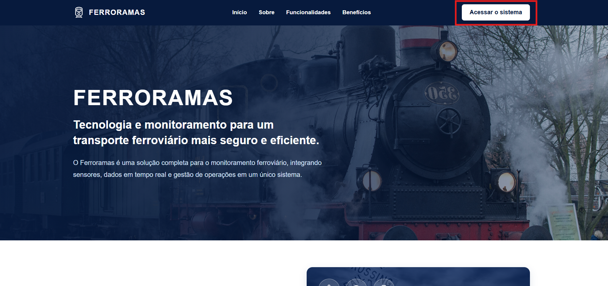

> Se o sistema ainda não foi instalado, siga a seção **Como executar o projeto** do [README](README.md).

---

## 2. Login e logout

### Entrar no sistema

1. Na tela de login, digite seu **e-mail** e sua **senha**.
2. Clique em **Entrar**.
3. Se os dados estiverem certos, abre o **Dashboard**.

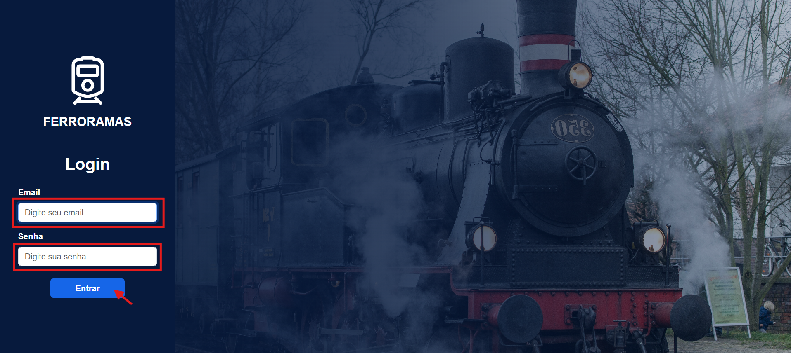

Se aparecer **"Email ou senha incorreta."** na parte de baixo da tela, verifique se o e-mail e a senha foram preenchidos corretamente e tente novamente. Se esqueceu a senha, peça a um administrador para cadastrar uma nova.

### Sair do sistema

1. Clique em **Sair**, no canto superior direito da barra azul.
2. Na janela **Confirmar logout**, clique em **Sair** de novo.
3. Você volta para a página inicial.

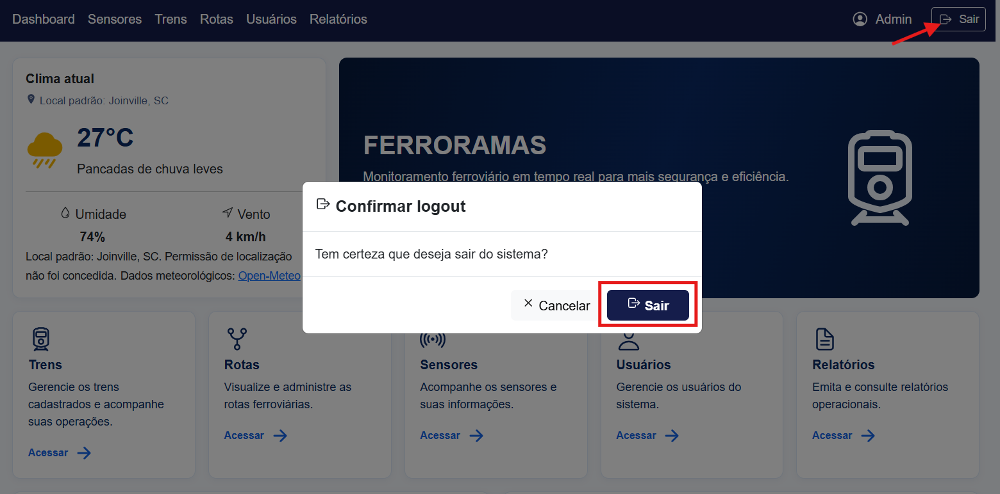
---

## 3. Navegação

Todas as telas internas têm a mesma **barra azul no topo**:

| Item | O que abre |
|---|---|
| **Dashboard** | Tela inicial, com o resumo da operação |
| **Sensores** | Lista de sensores |
| **Trens** | Lista de trens |
| **Rotas** | Lista de rotas |
| **Usuários** | Lista de usuários *(aparece só para o administrador)* |
| **Relatórios** | Relatório geral do sistema |

No lado direito da barra ficam o **seu nome** e o botão **Sair**.

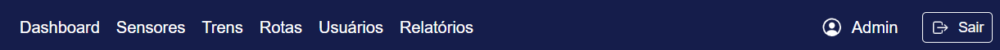

> No celular, os itens ficam escondidos no botão de menu (☰), no canto da barra.

---

## 4. Dashboard

O Dashboard é a primeira tela depois do login e mostra um resumo do sistema.

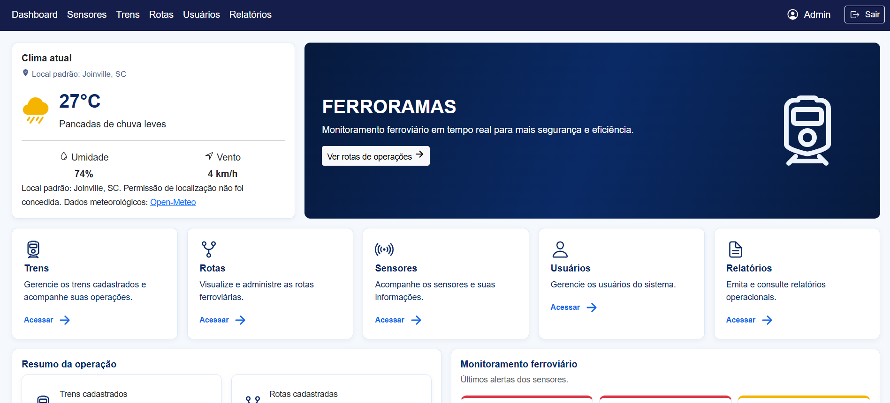
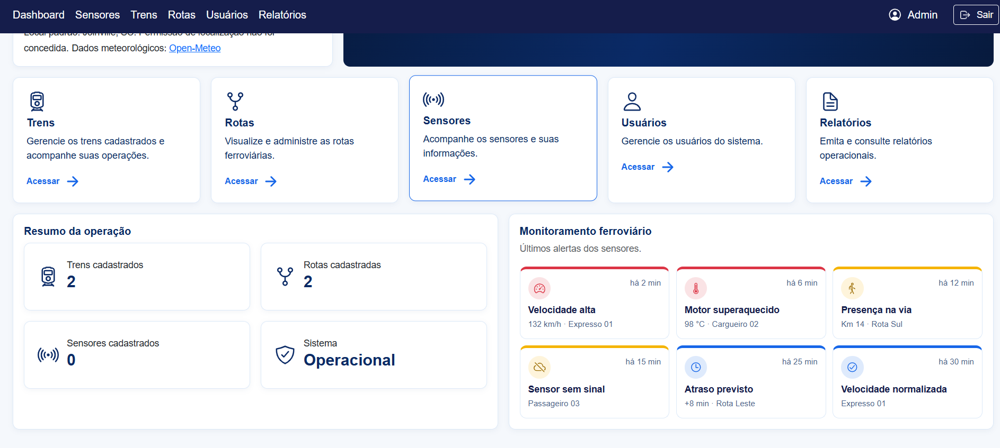

| Parte da tela | O que mostra |
|---|---|
| **Clima atual** | Temperatura e condição do tempo no local onde você está. O navegador vai pedir permissão para usar sua localização; se você não permitir, aparece "Clima indisponível". |
| **Atalhos** | Cartões para ir direto a Trens, Rotas, Sensores, Usuários (só administrador) e Relatórios. |
| **Resumo da operação** | Quantidade de **trens**, **rotas** e **sensores** cadastrados, e a situação do sistema. |
| **Monitoramento ferroviário** | Os últimos alertas dos sensores. |

### Como ler os alertas

Cada alerta é um quadro com ícone, título, um detalhe (valor e local) e há quanto tempo aconteceu. A **faixa colorida no topo** indica a gravidade:

| Cor da faixa | Nível | O que fazer |
|---|---|---|
| 🔴 Vermelho | **Crítico** | Exige ação imediata (ex.: velocidade acima do limite). |
| 🟡 Amarelo | **Atenção** | Precisa ser acompanhado (ex.: sensor sem sinal). |
| 🔵 Azul | **Informativo** | Apenas informação (ex.: atraso previsto). |

> **Observação:** nesta versão, os alertas exibidos são **exemplos de demonstração**. Eles ainda não vêm das leituras reais dos sensores.

---

## 5. Como as telas de cadastro funcionam

As telas de **Trens, Rotas, Sensores e Usuários** funcionam todas do mesmo jeito.

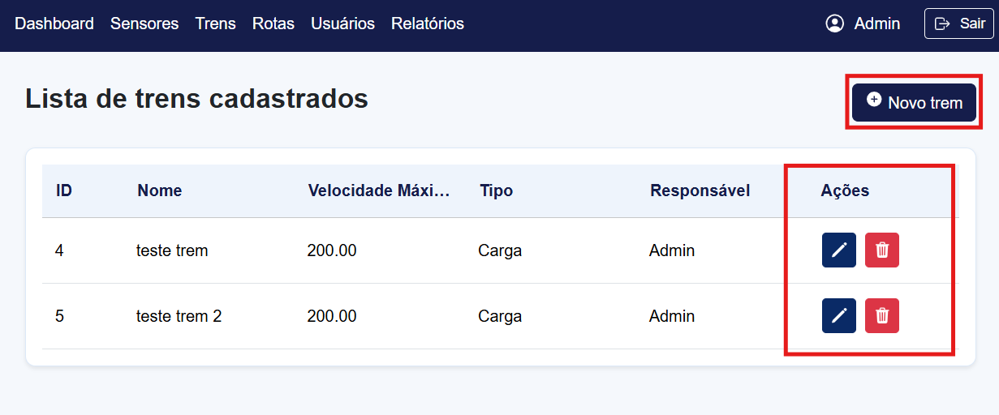

| Para... | Faça assim |
|---|---|
| **Consultar** | Abra a tela pela barra azul. Os registros aparecem em uma tabela. |
| **Cadastrar** | Clique no botão **Novo...** (canto superior direito), preencha a janela e clique em **Salvar**. |
| **Editar** *(administrador)* | Clique no ícone do **lápis** na coluna **Ações**, altere e clique em **Salvar alterações**. |
| **Excluir** *(administrador)* | Clique no ícone da **lixeira** e confirme em **Excluir**. Essa ação não pode ser desfeita. |

- **Nome dos botões:** passe o mouse sobre o lápis ou a lixeira para ver o nome do botão.
- **Se algo estiver errado no formulário:** a janela continua aberta, com uma mensagem vermelha explicando o problema. O que você digitou não se perde.
- **Depois de salvar ou excluir:** aparece uma mensagem verde de confirmação abaixo da tabela.

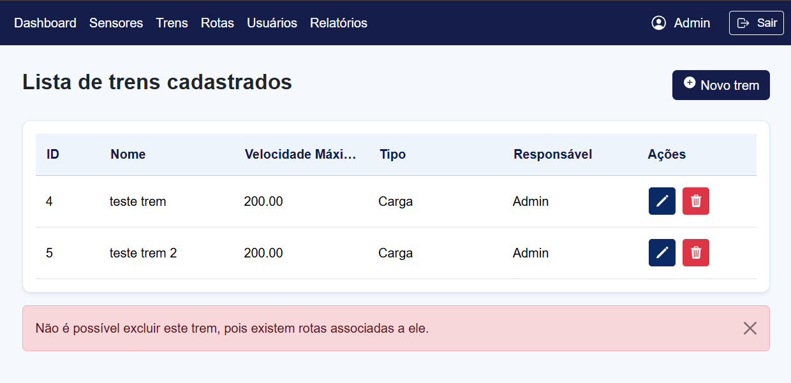

---

## 6. Trens

**Barra azul → Trens**

### Cadastrar um trem

1. Clique em **Novo trem**.
2. Preencha:
   - **Nome do Trem**;
   - **Velocidade Máxima** (em km/h, até 999,99);
   - **Tipo de Trem:** Passageiro, Carga ou Expresso;
   - **Responsável:** o usuário que cuida do trem.
3. Clique em **Salvar**.

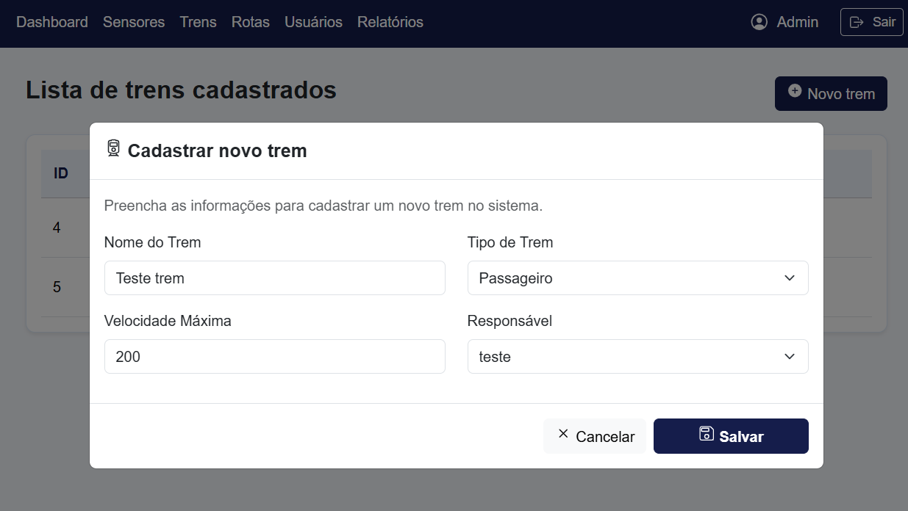

> O trem é cadastrado **sem rota**. A rota em que ele anda é escolhida depois, no cadastro da rota.

### Consultar

A tabela mostra **ID, Nome, Velocidade Máxima, Tipo e Responsável** de cada trem.

### Excluir

Um trem **não pode ser excluído** se:
- estiver associado a uma **rota**. Primeiro troque o trem da rota ou exclua a rota;
- tiver **sensores** instalados nele. Primeiro exclua ou mude os sensores de lugar.

---

## 7. Rotas

**Barra azul → Rotas**

### Cadastrar uma rota

1. Clique em **Nova rota**.
2. Preencha:
   - **Nome da Rota**;
   - **Extensão** (em km);
   - **Tempo estimado** (em minutos);
   - **Trem:** o trem que anda nesta rota. Ao lado de cada trem aparece onde ele está hoje, por exemplo "(sem rota)" ou "(hoje na rota Norte)";
   - **Descrição:** trajeto, estações, observações.
3. Clique em **Salvar**.

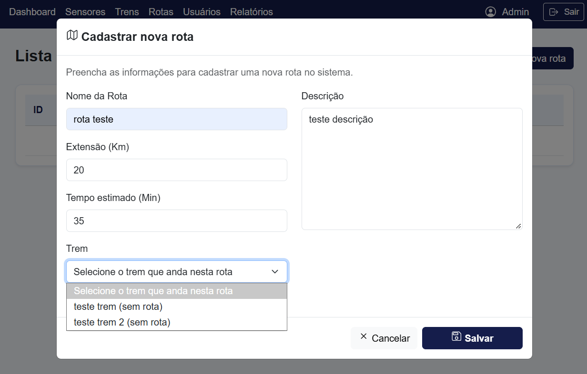

> Se o trem escolhido já estava em outra rota, ele **passa para esta**.
>
> Se ainda não houver nenhum trem, use o link **Cadastrar trem** que aparece no formulário.

### Consultar

A tabela mostra **ID, Nome, Descrição, Extensão, Tempo estimado e os Trens** que andam em cada rota.

### Editar (administrador)

Na edição também é possível **trocar o trem** da rota. O trem anterior fica sem rota.

### Excluir

- Ao excluir uma rota, os trens dela ficam **sem rota**.
- A rota **não pode ser excluída** se tiver **sensores** instalados nela.

---

## 8. Sensores

**Barra azul → Sensores**

### Cadastrar um sensor

1. Clique em **Novo sensor**.
2. Preencha:
   - **Nome do Sensor**;
   - **Localização do Sensor:** clique em **Rota** ou **Trem**;
   - logo abaixo, escolha **qual** rota ou **qual** trem;
   - **Tipo de Dado:** Temperatura, Velocidade ou Presença.
3. Clique em **Salvar**.

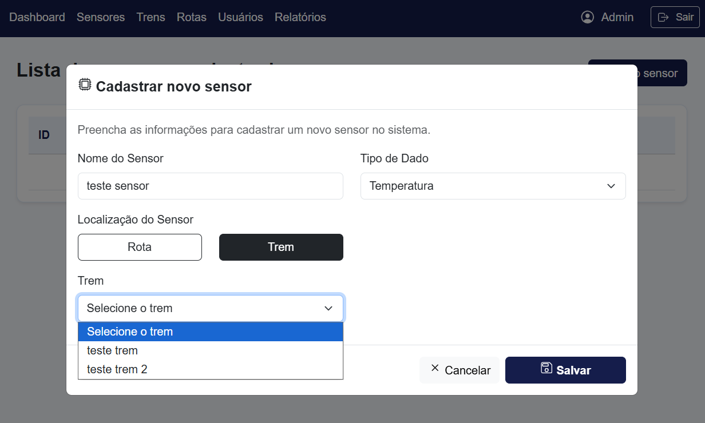

### Consultar

A tabela mostra **ID, Nome, Localização** (ex.: "Trens: Expresso 01") e **Tipo de dado**.

### Excluir

Um sensor **não pode ser excluído** se já tiver **leituras** registradas.

---

## 9. Usuários (somente administrador)

**Barra azul → Usuários.** Esse item só aparece para administradores.

### Cadastrar um usuário

1. Clique em **Novo usuário**.
2. Preencha:
   - **Nome Completo**, **Email** e **Senha**;
   - **Cargo:** **Administrador** ou **Funcionário** (ver item 11);
   - **Telefone:** digite só os números, a máscara é aplicada sozinha;
   - **CEP:** ao digitar os 8 números (ou clicar em **Buscar CEP**), Logradouro, Bairro, Cidade e UF são preenchidos automaticamente. Os campos podem ser corrigidos à mão.
3. Clique em **Salvar**.

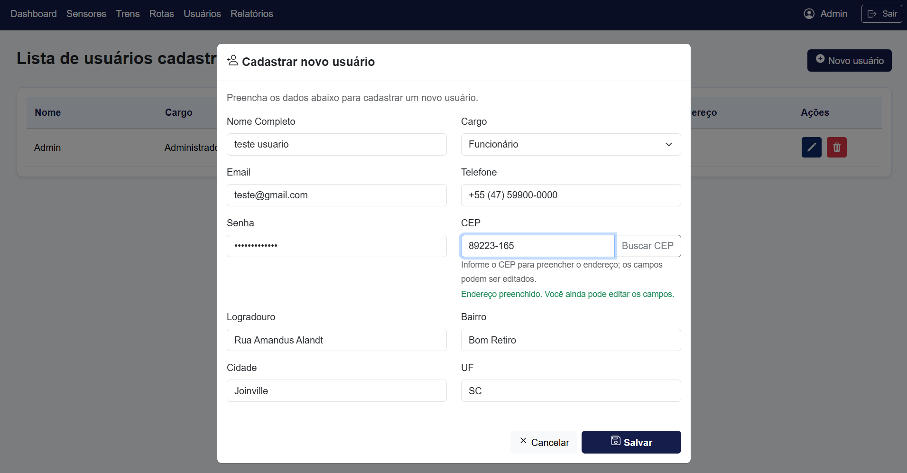

> Cada e-mail só pode ser usado por **um** usuário.

### Consultar

A tabela mostra **Nome, Cargo, Email, Telefone, CEP e Endereço**.

### Editar e trocar senha

Ao editar, o campo **Nova senha** pode ficar **em branco** para manter a senha atual. Para trocar a senha de alguém, preencha esse campo.

### Excluir

Não é possível excluir:
- um usuário que é **responsável por algum trem**. Primeiro troque o responsável do trem;
- o **único administrador** do sistema.

---

## 10. Relatórios

**Barra azul → Relatórios**

Abre o **relatório geral do sistema**, sempre com os dados atuais:

- quadros com os totais (trens, trens sem rota, rotas, sensores e leituras);
- **Trens:** responsável, rota e quantidade de sensores;
- **Rotas:** extensão, tempo e trens que andam em cada uma;
- **Sensores:** onde cada um está instalado;
- **Últimas leituras** dos sensores;
- **Usuários** (somente para o administrador).

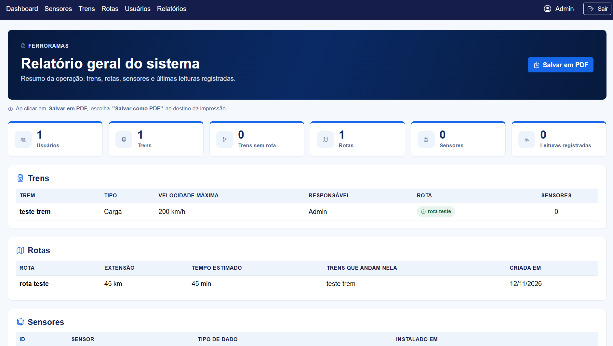

### Salvar em PDF

1. Clique em **Salvar em PDF**.
2. Na janela de impressão, em **Destino**, escolha **Salvar como PDF**.
3. Clique em **Salvar** e escolha onde guardar o arquivo.

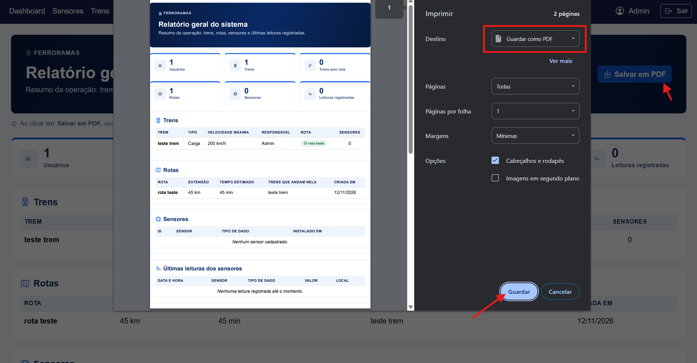

---

## 11. O que é exclusivo do administrador

| Ação | Administrador | Funcionário |
|---|:---:|:---:|
| Ver dashboard, trens, rotas, sensores e relatórios | ✅ | ✅ |
| Cadastrar trens, rotas e sensores | ✅ | ✅ |
| Salvar o relatório em PDF | ✅ | ✅ |
| **Editar** e **excluir** trens, rotas e sensores | ✅ | ❌ |
| Acessar a tela de **Usuários** (cadastrar, editar, excluir) | ✅ | ❌ |
| Ver os dados dos usuários no relatório | ✅ | ❌ |

Para o funcionário, os botões de lápis e lixeira e o item **Usuários** da barra não aparecem. Se ele tentar acessar uma tela restrita pelo endereço, o sistema mostra a página de **acesso negado**.

---

## 12. Mensagens e problemas comuns

| Mensagem ou situação | O que significa / o que fazer |
|---|---|
| "Email ou senha incorreta." | Confira o e-mail e a senha. Se esqueceu a senha, peça a um administrador. |
| "Preencha todos os campos." | Algum campo obrigatório ficou vazio no formulário. |
| "Este e-mail já está cadastrado." | Já existe um usuário com esse e-mail; use outro. |
| "Não é possível excluir este trem, pois existem rotas associadas a ele." | Troque o trem da rota (editando a rota) ou exclua a rota antes. |
| "...pois existem sensores associados..." | Exclua ou mude os sensores de lugar antes de excluir o trem ou a rota. |
| "...pois ele está associado a um ou mais trens." | Troque o responsável dos trens antes de excluir o usuário. |
| "Clima indisponível" no dashboard | O navegador não permitiu usar a localização, ou não há internet. |
| A busca de CEP não preencheu o endereço | Confira o CEP ou a internet; os campos podem ser preenchidos à mão. |
| A tela parece desconfigurada depois de uma atualização | Aperte **Ctrl + F5** para recarregar a página sem cache. |
| Não aparecem os botões de editar e excluir | Você está logado como **funcionário**; essas ações são do administrador. |