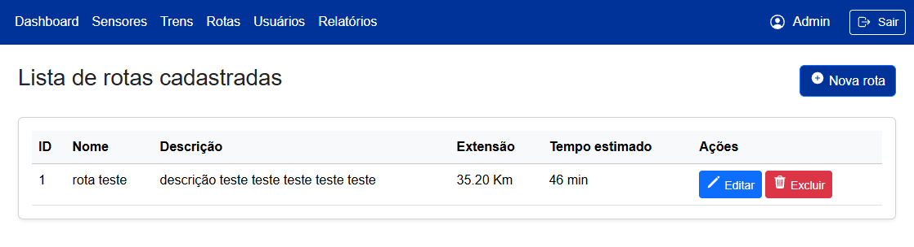
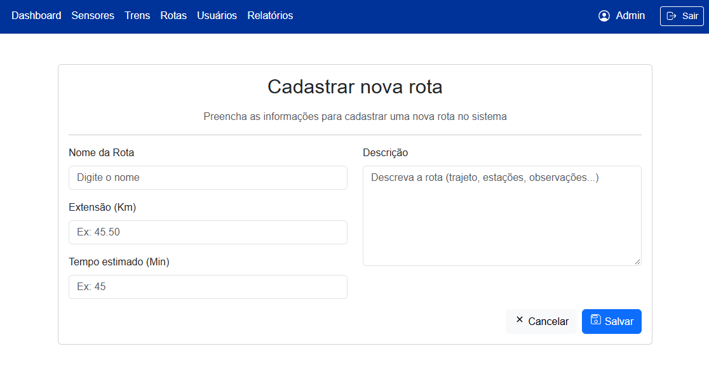
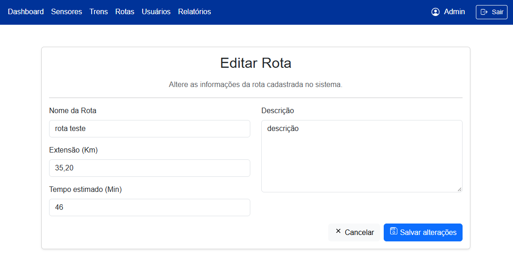
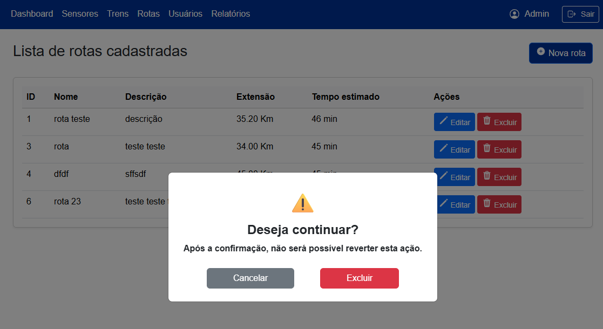

# 1. Versão anterior — proposta inicial

Na primeira versão, organizamos a ideia do Ferroramas a partir de telas separadas para cada ação. Assim, visualizar, cadastrar e editar apareciam como páginas ou telas diferentes. Essa organização ajudava a representar cada etapa de forma isolada, mas também deixava a navegação mais dividida: para realizar uma tarefa, o usuário precisaria sair de uma tela e acessar outra.

**Imagens da versão anterior:**

A proposta inicial serviu para definir quais informações seriam importantes no sistema e como os módulos poderiam ser organizados. Durante o desenvolvimento, percebemos que algumas decisões poderiam ser simplificadas para tornar o uso mais direto.

---

# 2. Versão final — sistema desenvolvido

Consideramos como versão final a implementação que está no repositório do projeto. Os mockups foram referências de planejamento e não representam uma versão final construída no Canva. A implementação reúne em uma plataforma os módulos de trens, sensores, rotas, usuários, dashboard e relatórios, com acesso conforme o perfil do usuário.

Nas telas de visualização, mantivemos a listagem dos registros como ponto central. As operações de cadastro e edição são realizadas em janelas modais, enquanto a exclusão solicita confirmação. Dessa forma, o usuário consegue trabalhar com os dados sem precisar navegar por várias páginas para cada operação.

Além das mudanças na organização das funcionalidades, foram realizados ajustes na interface para aproximar as diferentes telas da identidade visual definida pela equipe na Landing Page, buscando uma apresentação mais profissional, uniforme e harmoniosa.

As imagens finais do projeto estão presentes no [README](../README.md#como-executar-o-projeto).

---

# 3. Comparação — interface e decisões técnicas

## Interface

A principal mudança em relação à proposta antiga foi deixar de separar cadastro, edição e visualização em telas distintas. Seguindo a recomendação do professor, escolhemos concentrar essas operações na própria tela de listagem, utilizando modais. Fizemos essa escolha porque entendemos que ela reduz etapas, evita trocas constantes de página e mantém o contexto do registro que está sendo consultado.

Também adotamos uma identidade visual baseada em tons de azul e fundos claros. A intenção foi manter uma aparência relacionada à tecnologia e à segurança, sem prejudicar a leitura. Para isso, realizamos alterações em diferentes partes do sistema, buscando manter uma identidade visual consistente entre as funcionalidades.

### Alterações visuais realizadas

1. **Padronização das telas de usuários, trens, rotas e sensores:** alteramos as cores da barra de navegação (navbar) e dos botões, adotando tons de azul mais escuros para manter um padrão visual entre as funcionalidades.

2. **Home Page:** modificamos a cor do banner principal para um azul mais escuro, seguindo a identidade visual da Landing Page. Também fixamos a barra de navegação durante a rolagem da página, permitindo que ela permaneça acessível enquanto o usuário percorre o conteúdo.

3. **Landing Page:** corrigimos o nome do sistema, que anteriormente aparecia como "Ferrorama", para "Ferroramas", mantendo a identificação correta do projeto.

4. **Tela de login:** substituímos a imagem de fundo por uma opção mais profissional, com tons que combinam com o restante do sistema. Também alteramos a cor do botão de entrada, do título "FERRORAMAS" e do ícone do trem, utilizando um modelo já presente em outras telas para manter a padronização.

5. **Telas de visualização (sensores, rotas, trens, usuários e relatórios):** modificamos o funcionamento das operações de cadastro e edição. Anteriormente, ao selecionar essas opções, o usuário era redirecionado para uma página separada. Agora, os formulários são apresentados em janelas modais (modals) diretamente nas respectivas telas de visualização, tornando a navegação mais prática e centralizando as operações em um único ambiente.

6. **Padronização tipográfica:** definimos uma única fonte para os textos de todo o sistema, garantindo maior uniformidade visual e consistência entre as páginas.

7. **Encerramento de sessão:** alteramos o redirecionamento após o logout, fazendo com que o usuário seja direcionado para a Landing Page, em vez de retornar diretamente à tela de login.

8. **Organização das tabelas:** ajustamos a exibição e o posicionamento das ações disponíveis e dos identificadores (IDs) dos registros nas telas de visualização de sensores, trens, rotas e usuários, buscando melhorar a organização e a padronização das informações.

9. **Ícone do trem:** alteramos a cor do símbolo do trem para branco, proporcionando maior contraste e melhor integração com os elementos visuais do sistema.

### Decisões de design e justificativas

As alterações foram realizadas considerando a identidade visual definida pela equipe e a necessidade de proporcionar uma experiência de utilização mais organizada e intuitiva. As principais decisões foram:

- **Utilização de tons mais escuros de azul:** a equipe preferiu essa paleta por transmitir uma aparência mais profissional e combinar melhor com a proposta de um sistema de gerenciamento ferroviário.

- **Padronização de botões, navbar e ícones:** buscamos manter a mesma identidade visual nas diferentes páginas, evitando que cada tela apresentasse uma aparência diferente. Essa padronização também facilita o reconhecimento das funcionalidades pelo usuário.

- **Atualização da imagem de fundo do login:** substituímos a imagem anterior por uma opção mais adequada à identidade visual do sistema, buscando uma apresentação mais coerente e profissional.

- **Padronização da fonte:** a utilização de uma única tipografia foi escolhida para proporcionar maior consistência visual, melhorar a organização dos elementos textuais e reforçar a identidade do sistema.

- **Fixação da barra de navegação na Home Page:** essa decisão facilita o acesso às opções de navegação, evitando que o usuário precise retornar ao topo da página para utilizá-las.

- **Utilização de modais para cadastro e edição:** escolhemos essa organização para simplificar a navegação, reduzir a necessidade de redirecionamentos entre páginas e permitir que as operações sejam realizadas sem sair da tela de visualização correspondente.

- **Redirecionamento para a Landing Page após o logout:** essa alteração proporciona uma experiência de navegação mais coerente, permitindo que o usuário retorne à página inicial de apresentação do sistema após encerrar sua sessão.

- **Padronização das ações e dos identificadores dos registros:** ajustamos a organização dos botões de ação e dos IDs nas tabelas para facilitar a identificação dos registros e tornar a utilização das funcionalidades mais intuitiva.

- **Alteração da cor do símbolo do trem para branco:** escolhemos essa cor para melhorar o contraste do ícone com o fundo, garantindo maior visibilidade e harmonia com a identidade visual adotada.

### Dificuldade visual encontrada e solução

Uma das dificuldades encontradas durante o desenvolvimento foi manter a identidade visual consistente entre as diversas telas do sistema, principalmente porque algumas ainda utilizavam cores diferentes das escolhidas para a Landing Page.

Para resolver essa questão, aplicamos tons de azul mais escuros nos principais elementos da interface e padronizamos componentes como botões, ícones, tipografia e barras de navegação. Também realizamos ajustes específicos em páginas como a Home Page e a tela de login. Dessa forma, conseguimos aproximar a aparência dos diferentes módulos e criar uma interface mais uniforme e alinhada à identidade visual definida pela equipe.

## Decisões técnicas

Na construção da interface, optamos por utilizar HTML, CSS e JavaScript, com Bootstrap para aproveitar componentes e recursos responsivos. Essa escolha permitiu manter um padrão visual entre as telas e agilizar a construção de elementos recorrentes, como tabelas, botões e modais.

Também utilizamos APIs externas para recursos específicos: a Open-Meteo apresenta informações climáticas no dashboard e a ViaCEP auxilia no preenchimento do endereço a partir do CEP.

Além disso, utilizamos o Ionicons como biblioteca de ícones, pois oferece opções para representar visualmente as ações e funcionalidades do sistema. Escolhemos essa ferramenta para manter um padrão visual e aproveitar ícones com códigos prontos, facilitando sua implementação.

---

# 4. Decisões sobre organização dos dados e uso

Ao organizar os dados, buscamos manter as informações principais em estruturas que fossem compreensíveis e suficientes para as funcionalidades previstas. Por isso, a modelagem foi simplificada e não mantivemos uma tabela associativa. A intenção foi evitar uma estrutura adicional que não consideramos necessária para a forma como o projeto ficou organizado.

Também não mantivemos a tabela de registro de acesso. Priorizamos as informações diretamente relacionadas à operação ferroviária e ao funcionamento dos módulos, como usuários, cargos, trens, rotas, sensores, leituras e relatórios. Essa organização mantém o foco nos dados necessários para consultar e acompanhar as operações.

A separação entre administrador e funcionário foi mantida porque os dois perfis não precisam realizar as mesmas ações. Essa diferenciação evita disponibilizar operações administrativas para todos os usuários e torna o acesso mais adequado às responsabilidades de cada perfil.

Organizamos os arquivos de cada módulo (usuário, trem, rota e sensor) de acordo com suas responsabilidades:

- **Arquivo visualizar:** prepara e executa as consultas SQL necessárias para apresentar os registros e também controla as mensagens exibidas ao usuário.

- **Arquivos cadastrar e editar:** são responsáveis por apresentar os modais e seus formulários, sem realizar diretamente a gravação dos dados.

- **Arquivo excluir:** concentra o processamento da exclusão, utilizando PHP e as consultas SQL necessárias, além de apresentar um modal de confirmação.

Dessa forma, cada arquivo possui uma responsabilidade específica, mantendo o controle das mensagens centralizado no visualizar.

---

# 5. Considerações finais

Ao longo do desenvolvimento, nossas escolhas foram sendo ajustadas conforme avaliamos a proposta inicial, as orientações recebidas e as necessidades do sistema. A decisão de concentrar as operações em modais, padronizar os componentes visuais e simplificar a organização dos dados teve como objetivo deixar o Ferroramas mais direto e coerente para quem utiliza a plataforma.

As alterações visuais também foram importantes para aproximar as diferentes telas da identidade visual definida pela equipe. A padronização das cores, da tipografia, dos botões, dos ícones e da navegação contribuiu para tornar a interface mais organizada, profissional e harmoniosa. Além disso, os ajustes de navegação e posicionamento dos elementos buscaram facilitar a utilização das funcionalidades e melhorar a experiência do usuário.

A versão presente no repositório representa o resultado dessas decisões e do trabalho realizado em equipe. Mais do que reproduzir os mockups, buscamos adaptar a proposta para uma solução funcional, considerando a experiência do usuário, a clareza das informações, a consistência visual e a organização dos módulos.
